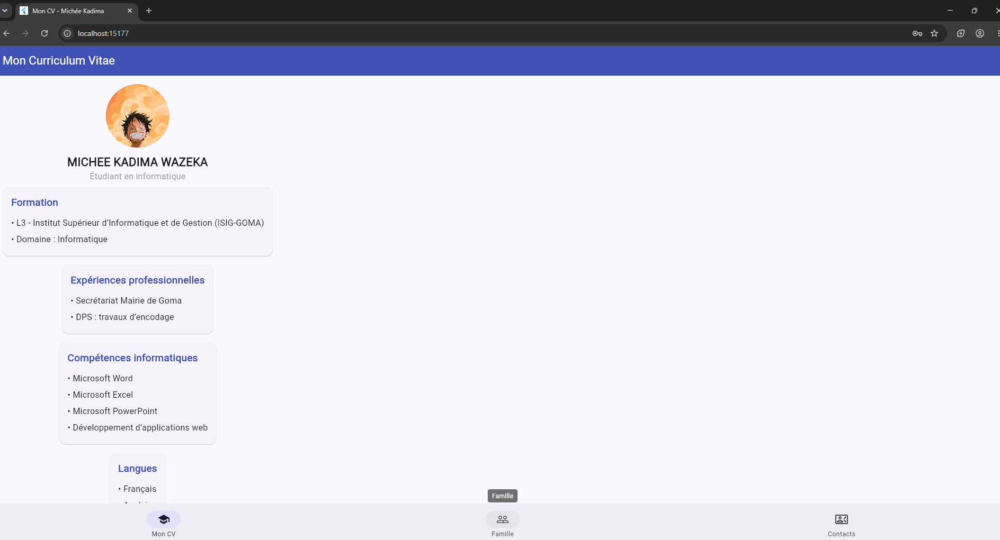
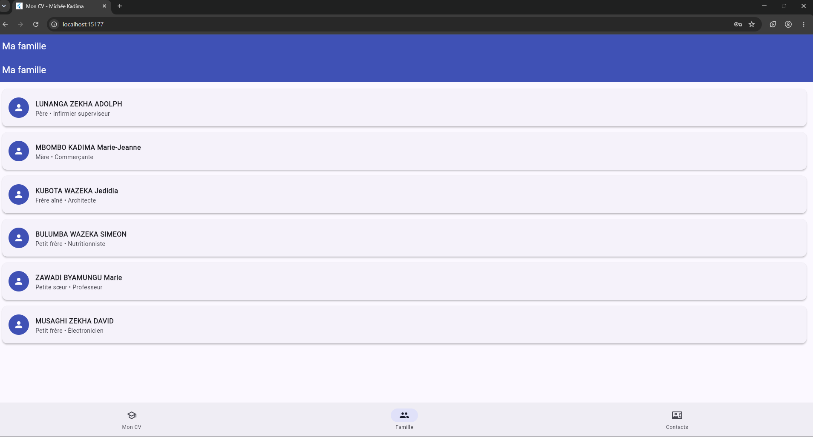

# Mon CV — Application Flutter

Application mobile développée avec **Flutter** et **Dart** pour présenter le
curriculum vitae de **Michée Kadima Wazeka**. Le projet comprend l’authentification
via une API REST, un CV responsive, une gestion CRUD des membres de la famille
et une page de coordonnées.

## Aperçu

| Écran de connexion | Curriculum vitae |
|:---:|:---:|
|  |  |

| Famille | Contacts |
|:---:|:---:|
|  |  |

## Démonstration vidéo

Une démonstration complète du projet TP2 est disponible :

**[Voir ou télécharger la vidéo TP2](videos/tp2-demo.mp4)**

## Fonctionnalités

- Création de compte et connexion avec adresse e-mail et mot de passe.
- Affichage du parcours académique, des expériences, des compétences et des langues.
- Interface responsive adaptée aux écrans téléphones, tablettes et bureau.
- Ajout, consultation, modification et suppression des membres de la famille.
- Affichage des coordonnées personnelles et professionnelles.
- Messages d’erreur API, état de chargement et déconnexion.
- Support de `--dart-define=API_BASE_URL` pour chaque environnement.

## Technologies

- Flutter / Dart
- Package HTTP
- Material 3
- API REST PHP
- MySQL
- Flutter Test

## Prérequis

- Flutter SDK compatible avec Dart `^3.9.2`
- Android Studio, VS Code ou un autre éditeur Flutter
- Chrome pour les tests web
- XAMPP avec Apache et MySQL
- API `api-test` disponible sur GitHub :
  [espoirbaraka/api-test](https://github.com/espoirbaraka/api-test)

Vérifiez l’installation :

```powershell
flutter doctor
flutter --version
```

## Installation

Cloner le dépôt :

```powershell
git clone https://github.com/micheek845-web/cv_flutter_michee.git
cd cv_flutter_michee
flutter pub get
```

## Configuration de l’API

L’application utilise l’API
[api-test](https://github.com/espoirbaraka/api-test). Configurez Apache, MySQL
et l’API selon les instructions de son dépôt, puis importez sa base `api`.

L’application prévoit ces adresses par défaut :

- Android émulateur : `http://10.0.2.2:8080/api-test/public`
- Chrome, iOS simulateur et desktop : `http://localhost:8080/api-test/public`

Pour lancer l’application sous Chrome :

```powershell
flutter run -d chrome --dart-define=API_BASE_URL=http://localhost:8080/api-test/public
```

Pour lancer l’application sur l’émulateur Android :

```powershell
flutter run -d <device-id> --dart-define=API_BASE_URL=http://10.0.2.2:8080/api-test/public
```

Pour un téléphone physique, remplacez `localhost` par l’adresse IPv4 locale de
l’ordinateur hébergeant XAMPP :

```powershell
flutter run --dart-define=API_BASE_URL=http://ADRESSE_IP_LOCALE:8080/api-test/public
```

Le téléphone et l’ordinateur doivent être sur le même réseau. Apache doit
également autoriser les connexions HTTP entrant. Si Apache utilise le port `80`,
retirez `:8080` de l’adresse.

L’API attend les réponses JSON avec le format suivant :

```json
{
  "success": true,
  "data": []
}
```

## Routes utilisées

| Méthode | Route | Utilisation |
|---|---|---|
| `POST` | `/accounts/register` | Créer un compte |
| `POST` | `/accounts/login` | Connecter un utilisateur |
| `GET` | `/famille-membres` | Lire les membres |
| `POST` | `/famille-membres` | Ajouter un membre |
| `PUT` | `/famille-membres/{id}` | Modifier un membre |
| `DELETE` | `/famille-membres/{id}` | Supprimer un membre |

Toutes les routes sont relatives à l’adresse configurée par `API_BASE_URL`.

## Utilisation

### Première connexion

1. Lancez Apache et MySQL.
2. Lancez l’application Flutter.
3. Sélectionnez **Créer un compte**.
4. Saisissez une adresse e-mail valide et un mot de passe d’au moins six caractères.
5. Après l’inscription, le compte peut être utilisé pour se connecter.

Il n’existe aucun mot de passe prédéfini dans le projet.

### Gestion des membres

Chaque membre requiert :

- Nom
- Postnom
- Prénom
- Lieu de naissance
- Date de naissance
- Lien de parenté

Les membres sont enregistrés dans l’API et non uniquement en mémoire dans
l’application. La session actuelle n’utilise pas de jeton d’accès : les
identifiants sont vérifiés lors de la connexion.

## Structure du projet

```text
lib/
├── data/
│   ├── api_service.dart
│   ├── family_member.dart
│   └── profile_data.dart
├── screens/
│   ├── login_screen.dart
│   ├── register_screen.dart
│   ├── home_screen.dart
│   ├── cv_resume_screen.dart
│   ├── family_screen.dart
│   └── contact_screen.dart
└── main.dart
test/
├── api_service_test.dart
└── widget_test.dart
assets/
└── images/
    └── profil.png
screenshots/
```

## Tests

Exécuter tous les tests :

```powershell
flutter test
```

Analyser le code Dart :

```powershell
flutter analyze
```

Les tests couvrent notamment :

- l’échec de connexion ;
- l’affichage du mot de passe ;
- la navigation vers le CV après connexion réussie ;
- la navigation entre les écrans ;
- l’adaptation du CV aux petits écrans ;
- les appels REST de création, lecture, modification et suppression.

## Compilation

Android :

```powershell
flutter build apk --release
```

Le fichier APK est généré dans `build/app/outputs/flutter-apk/`.

Web :

```powershell
flutter build web --release --dart-define=API_BASE_URL=http://localhost:8080/api-test/public
```

Windows :

```powershell
flutter build windows --release
```

## Dépannage

- **Aucune connexion** : vérifiez Apache, MySQL, le port et le chemin `/api-test/public`.
- **Certificat ou réponse invalide** : assurez-vous que l’adresse renvoie du JSON.
- **Émulateur Android** : utilisez `10.0.2.2`, pas `localhost`.
- **Téléphone physique** : autorisez le HTTP local et utilisez l’adresse IPv4 de l’ordinateur.
- **Page sans données** : vérifiez que la base `api` contient les tables attendues.
- **Erreur de dépendances** : exécutez `flutter clean`, puis `flutter pub get`.

## Auteur

- **Nom** : Michée Kadima Wazeka
- **Établissement** : ISIG-GOMA
- **Niveau** : Licence 3
- **Domaine** : Informatique
- **E-mail** : micheek845@gmail.com

Projet académique réalisé dans le cadre du TP2.
