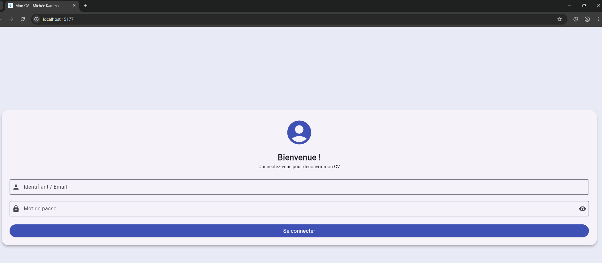
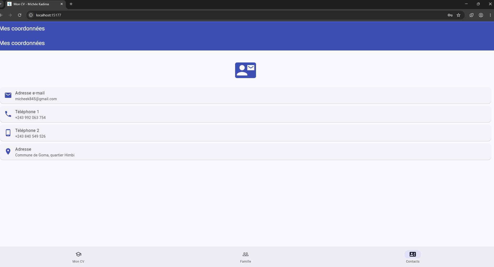

APPLICATION MOBILE – MON CV

Développée par Michée Kadima Wazeka

1. Présentation du projet

Cette application mobile a été réalisée avec Flutter et le langage Dart dans le cadre d’un travail pratique.

Elle permet de présenter mon curriculum vitae, les membres de ma famille et mes coordonnées personnelles.

L’accès à l’application se fait à travers une page de connexion.

2. Objectifs de l’application

* Présenter mon parcours académique et professionnel.
* Afficher mes compétences informatiques.
* Présenter les membres de ma famille.
* Mettre à disposition mes coordonnées personnelles.
* Faciliter la navigation entre les différentes pages.

3. Fonctionnalités

* Page de connexion : permet d’accéder à l’application.
* Page Mon CV : présente mon profil, ma formation, mes compétences et mes expériences.
* Page Famille : présente les membres de ma famille.
* Page Contacts : affiche mes numéros de téléphone, mon adresse et mon adresse électronique.
* Navigation : permet de passer facilement d’une page à une autre.

4. Technologies utilisées

* Flutter
* Dart
* Visual Studio Code
* Android Studio

5. Captures d’écran

Page de connexion

Page Mon CV

Page Famille

Page Contacts

6. Structure du projet

cv_flutter_michee/
├── lib/
│   ├── main.dart
│   └── screens/
│       ├── login_screen.dart
│       ├── home_screen.dart
│       ├── family_screen.dart
│       └── contact_screen.dart
├── assets/
│   └── images/
│       └── profil.png
├── screenshot/
├── pubspec.yaml
└── README.md

7. Installation et exécution

Pour exécuter le projet :

1. Ouvrir le dossier dans Visual Studio Code.
2. Ouvrir le terminal.
3. Exécuter :

flutter pub get

4. Puis lancer l’application :

flutter run

8. Auteur

Nom : Michée Kadima Wazeka
Établissement : ISIG-GOMA
Niveau : L3
Domaine : Informatique

⸻

Projet académique développé avec Flutter et Dart.
### PAGE DE CONNEXION

### PAGE MON CV

### PAGE DE FAMILLE

### PAGE CONTACTS

